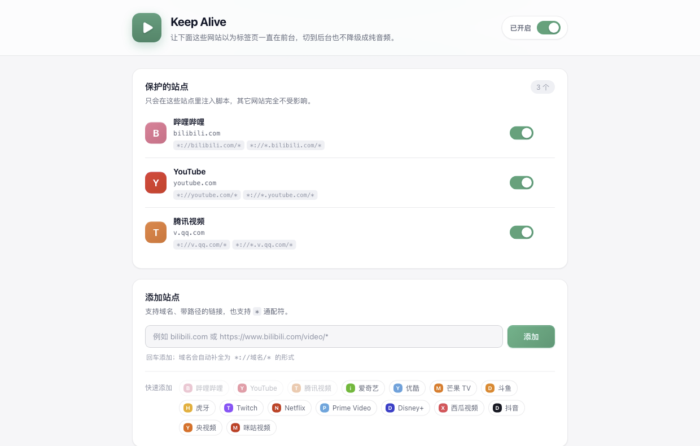

# Keep Alive · 后台视频常亮

> 切到别的标签页，B 站也不再把视频降级成纯音频；切回来不卡顿、不重新缓冲。

一个 Chrome / Edge 扩展（Manifest V3）。它让**你指定的那些网站**始终以为标签页在前台，从而跳过播放器的"后台省流"逻辑。



---

## 它解决什么问题

很多视频网站会在标签页失去可见性时切换到"只播音频"模式：

- B 站的播放器会启动一个定时器，几秒后调用 `disableVideo(true)`，只保留音频轨道；切回前台再重新启用视频轨道、重建解码器 —— 这就是切回来那一下卡顿和"缓冲中"的来源。
- 其它站点也大多基于同一套 Page Visibility API：`document.visibilityState` 变成 `hidden`、派发 `visibilitychange`、窗口 `blur`。

扩展做的事情很直接：**在该站点加载之前，把"你切走了"这件事从页面眼里抹掉。**

## 原理

在目标站点 `document_start` 阶段注入到页面世界（MAIN world），做四件事：

1. **改写可见性**：`document.hidden` 恒为 `false`，`document.visibilityState` 恒为 `"visible"`，同时覆盖 `webkitHidden` / `webkitVisibilityState`。
2. **改写焦点**：`document.hasFocus()` 恒为 `true`。
3. **拦截事件**：在 `window` 的捕获阶段吞掉 `visibilitychange` / `webkitvisibilitychange` / 窗口 `blur`，页面里的监听器一个都收不到。
4. **保活渲染循环**（可选）：后台时接管 `requestAnimationFrame`，把被浏览器挂起的回调搬到自己的定时器里，避免播放器的动画循环彻底停摆。

另外：

- 标签页级别设置 `autoDiscardable: false`，降低内存紧张时被 Chrome 回收重载的概率。
- 顺手过滤 `performance.getEntriesByType("visibility-state")` 里留下的可见性记录。

> 这不是修改浏览器，而是让页面自己的判断失真。浏览器底层的省电调度仍然存在。

## 安装

Chrome / Edge 111+。

1. 拿到 `keep-alive` 目录（或解压 `keep-alive.zip`）。
2. 打开 `chrome://extensions`（Edge 是 `edge://extensions`），打开右上角 **开发者模式**。
3. 点 **加载已解压的扩展程序**，选择 `keep-alive` 目录。
4. 已经打开的标签页需要**刷新一次**才会生效。

首次安装会默认加入 `bilibili.com`，装完刷新 B 站页面即可。

## 使用

点工具栏图标打开弹窗：

- 顶部开关：全局启用 / 停用。
- 中间卡片：显示当前站点状态，一键"保持此站点活跃"或"停用此站点"。
- 状态是 **待生效** 时，点"刷新标签页"即可。
- 图标角标显示 **ON** 表示当前标签页正在受保护。

"站点与高级设置"里可以：

- 管理站点列表（启用 / 暂停 / 删除）。
- 从常见站点一键添加：B 站、YouTube、腾讯视频、爱奇艺、优酷、芒果 TV、斗鱼、虎牙、Twitch、Netflix、Prime Video、Disney+、西瓜视频、抖音、央视频、咪咕视频。
- 手动输入域名、链接或通配符。

### 匹配规则

| 输入 | 实际匹配 |
| --- | --- |
| `bilibili.com` | `*://bilibili.com/*`、`*://*.bilibili.com/*` |
| `https://www.bilibili.com/video/BV1xx` | `*://bilibili.com/video/BV1xx*`、`*://*.bilibili.com/video/BV1xx*` |
| `*.example.com` | `*://*.example.com/*`（只匹配子域名） |
| `localhost:3000` | `*://localhost/*` |
| `example.com/live/*` | `*://example.com/live/*`、`*://*.example.com/live/*` |

说明：

- `http` 和 `https` 都会匹配（忽略你输入的协议），避免站点跳转后失效。
- match pattern 不区分端口，所以端口会被忽略。
- 路径末尾会自动补 `*`，以保证带查询参数的链接也能命中。
- 输入 `www.` 前缀会自动归一到主域名。

## 验证是否生效

在受保护的页面里打开控制台：

```js
document.visibilityState; // 切到别的标签页后仍然是 "visible"
document.hidden;          // false
document.hasFocus();      // true
__keepAlive.state();      // { patched: true, realHidden: true/false, config, raf }
```

`__keepAlive.state().realHidden` 是浏览器给出的真实值，用来对比。

实感验证：打开一个 B 站视频 → 切到别的标签页 30 秒 → 切回来，进度条应该一直在走，画面连续，没有"缓冲中"。

## 高级选项

| 选项 | 默认 | 说明 |
| --- | --- | --- |
| 保持动画帧 | 开 | 后台时接管 `requestAnimationFrame`。受浏览器节流影响，后台大约每秒 1 帧，只保证循环不停摆。关闭可省电。 |
| 防止标签页被回收 | 开 | 对受保护站点设置 `autoDiscardable: false`，避免内存紧张时被丢弃重载。 |
| 拦截后台事件 | 开 | 吞掉 `visibilitychange` 和窗口 `blur`。关掉后大多数站点会立刻恢复原来的降级行为，一般不需要关。 |

设置修改后自动保存；**站点列表的变更需要刷新已打开的标签页**。

## 已知限制

- **只对 http / https 页面生效**，`chrome://`、扩展页、PDF 阅读器等无法注入。
- **无法绕过浏览器底层的节流**：后台标签页的定时器仍会被降频，`requestAnimationFrame` 不会真的以 60fps 运行。
- 如果站点在 **Web Worker / Service Worker** 里做可见性判断、或者用服务端心跳判断"是否在看"，页面里的改写拦不住。
- 少数播放器会用 `requestVideoFrameCallback`、FPS 统计、`IntersectionObserver` 等间接信号，可能仍然会降级。
- **DRM 视频**（Netflix、Disney+ 等）由 Widevine 控制，扩展不会也不能干预受保护媒体管线。
- 浏览器自身的自动播放策略、系统休眠、内存压力导致的媒体挂起，不在扩展的控制范围内。
- 这个方案本质上是**拿一点后台 CPU / 电量换流畅**；介意的话把"保持动画帧"关掉。
- 需要 Chrome / Edge 111+；Firefox 的动态内容脚本暂不支持 `world: "MAIN"`，未适配。

## 隐私与权限

- **不联网**：没有远程请求、没有统计上报、没有远程代码。
- **配置只存在本地**（`chrome.storage.sync`，会跟随浏览器账号同步）。
- `host_permissions: <all_urls>` 是因为站点列表由你自己填写，扩展需要有能力向任意站点注入；但脚本是通过 `chrome.scripting.registerContentScripts` **动态注册**的，**只会在你列表里的站点运行**，其它网站完全不受影响。
- 所有注入逻辑都在页面自己的 JS 环境里，不读取、不上传页面内容。

## 目录结构

```
keep-alive/
├── manifest.json
├── icons/                  # 16/32/48/128 图标
├── src/
│   ├── background.js       # Service Worker：注册内容脚本、角标、防回收
│   ├── content.js          # 隔离世界：转发配置、上报状态、响应弹窗探测
│   ├── inject.js           # 页面世界：可见性/焦点改写、事件拦截、rAF 保活
│   ├── popup.html/.css/.js
│   ├── options.html/.css/.js
│   ├── ui.css              # 共用设计变量与组件
│   └── shared/             # 站点匹配、存储、预设站点
├── docs/options.png
├── test/fixture.html       # 本地测试页（模拟"隐藏即降级"的播放器）
└── tools/make_icons.py     # 重新生成图标
```

## 开发与测试

```bash
# 重新生成图标（需要 Pillow）
python3 tools/make_icons.py

# 起一个本地测试页
python3 -m http.server 8765 --directory test
# 打开 http://127.0.0.1:8765/fixture.html
# 在扩展设置里把 127.0.0.1 加进站点列表，刷新页面
```

测试页会模拟一个"发现标签页隐藏就切到纯音频"的播放器；切到别的标签页再回来，`播放器模式` 应始终是 `video`，`页面收到的事件` 应保持为空。
